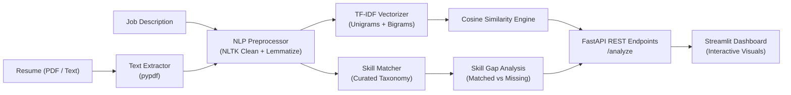

# 📄 Resume Analyzer & Job Matcher

An NLP-powered application and REST microservice that parses candidate resumes (PDF or raw text), calculates semantic keyword alignment against job descriptions using **TF-IDF Vectorization** and **Cosine Similarity**, extracts technical skill taxonomies, and generates actionable resume enhancement recommendations.

---

## 📌 Problem Statement
Job seekers frequently struggle to identify skill gaps and keyword misalignments between their resumes and target job descriptions. Traditional Applicant Tracking Systems (ATS) use keyword parsing and vector matching algorithms to screen candidates. This project provides a transparent, local, privacy-first tool to evaluate resume alignment, highlight missing requirements, and suggest actionable improvements.

---

## 🌟 Key Features
- **Flexible Ingestion:** Ingests resumes via text-based PDF uploads (`pypdf`) or direct plain text.
- **NLP Preprocessing Pipeline:** Lowercasing, URL/email removal, non-alphanumeric token filtering, NLTK English stopword elimination, and WordNet lemmatization.
- **TF-IDF & Cosine Similarity Scoring:** Vectorizes text using unigrams and bigrams (`ngram_range=(1, 2)`) to compute mathematical vector proximity (0–100 scale).
- **Curated Technical Skill Taxonomy:** Deterministic boundary regex extraction across 80+ categorized skills (Languages, Frameworks, Databases, DevOps, and Concepts).
- **Actionable Suggestions:** Generates targeted bullet-point recommendations for missing skills.
- **FastAPI Backend & Interactive Streamlit UI:** Production-ready REST endpoints (`/analyze`, `/health`, `/docs`) combined with an intuitive web dashboard.
- **Strict Privacy Guarantee:** 100% in-memory processing with zero file or personal data persistence on disk.

---

## 🏗️ Architecture & Flow



---

## 🛠️ Tech Stack
- **Backend API:** FastAPI, Uvicorn, Pydantic, HTTPX
- **Frontend Dashboard:** Streamlit
- **NLP & Machine Learning:** Scikit-Learn (TF-IDF, Cosine Similarity), NLTK (Stopwords, WordNet Lemmatizer)
- **Document Processing:** PyPDF
- **Testing & Quality Assurance:** Pytest (14 passing unit & integration tests)
- **Containerization:** Docker

---

## 📂 Project Structure
```text
resume-job-matcher/
├── app/
│   ├── __init__.py
│   ├── main.py              # FastAPI microservice routes & Pydantic models
│   ├── extractor.py         # In-memory PDF text extraction & validation
│   ├── preprocess.py        # Tokenization, cleaning & WordNet lemmatization
│   ├── matcher.py           # TF-IDF matrix & cosine similarity calculator
│   └── skills.py            # Skill taxonomy matching & gap analysis
├── data/
│   └── skills_list.csv      # Curated taxonomy (80+ technical skills)
├── frontend/
│   └── streamlit_app.py     # Interactive Streamlit dashboard
├── tests/
│   ├── __init__.py
│   ├── test_health.py       # API liveness & root tests
│   └── test_resume_matcher.py # 14 unit tests (extraction, scoring, API)
├── Dockerfile               # Production Docker container definition
├── requirements.txt         # Pinned Python package dependencies
├── .gitignore               # Ignored cache, virtualenvs & artifacts
└── README.md                # Comprehensive documentation
```

---

## 🚀 How to Run the Project

### Option A: Local Python Execution

#### 1. Clone & Navigate
```bash
git clone https://github.com/aparnabethineedi04/resume-job-matcher.git
cd resume-job-matcher
```

#### 2. Install Dependencies
```bash
pip install -r requirements.txt
```

#### 3. Run Automated Tests
```bash
python -m pytest tests/
```

#### 4. Start the FastAPI Microservice
```bash
uvicorn app.main:app --reload --port 8000
```
*Access interactive OpenAPI documentation at `http://127.0.0.1:8000/docs`.*

#### 5. Launch the Streamlit Frontend
```bash
streamlit run frontend/streamlit_app.py
```
*Access the web dashboard in your browser at `http://localhost:8501`.*

---

### Option B: Docker Container Execution

```bash
# Build the container image
docker build -t resume-job-matcher .

# Run the container
docker run -p 8000:8000 resume-job-matcher
```

---

## 📡 API Example: Request & Response

### Request (`POST /analyze`)
```bash
curl -X POST "http://127.0.0.1:8000/analyze" \
     -H "Content-Type: application/json" \
     -d '{
       "resume_text": "Experienced Python Backend Developer skilled in FastAPI, PostgreSQL, Docker, and REST APIs.",
       "job_description": "Looking for a Python Software Engineer with FastAPI, PostgreSQL, Docker, Kubernetes, and AWS."
     }'
```

### Response (`200 OK`)
```json
{
  "match_score": 18.37,
  "matched_skills": [
    {"skill": "PostgreSQL", "category": "Databases"},
    {"skill": "FastAPI", "category": "Frameworks"},
    {"skill": "Python", "category": "Languages"},
    {"skill": "Docker", "category": "DevOps"}
  ],
  "missing_skills": [
    {"skill": "Kubernetes", "category": "DevOps"},
    {"skill": "AWS", "category": "DevOps"}
  ],
  "extra_skills": [
    {"skill": "REST API", "category": "Concepts"}
  ],
  "suggestions": [
    "Add relevant experience or coursework showcasing: Kubernetes, AWS.",
    "Strong alignment on core skills: PostgreSQL, FastAPI, Python, Docker. Ensure these are highlighted in your project bullet points."
  ],
  "metadata": {
    "resume_words": 9,
    "job_words": 10,
    "total_job_skills": 6,
    "total_resume_skills": 5
  }
}
```

---

## 📊 Benchmark Results on 3 Sample Resume-Job Pairs

| Test Case | Candidate Profile vs. Target Role | Match Score | Matched Skills | Missing Skills |
| :--- | :--- | :---: | :--- | :--- |
| **Pair 1 (High Match)** | Senior Python Dev $\rightarrow$ Backend Python Role | **16.14%** | Microservices, PostgreSQL, FastAPI, Python, Docker, Flask, Redis, CI/CD | Data Structures, REST API |
| **Pair 2 (Moderate Match)** | Frontend React Dev $\rightarrow$ Full-Stack Python Role | **7.81%** | JavaScript, React | PostgreSQL, FastAPI, Python, Django, Docker, SQL, AWS |
| **Pair 3 (Low Match)** | Marketing Specialist $\rightarrow$ Cloud DevOps Role | **0.00%** | *None* | Kubernetes, Terraform, Jenkins, Python, Docker, GitHub, Linux, AWS |

---

## ⚠️ Limitations & Technical Trade-offs

1. **TF-IDF Ignores Deep Semantics:** TF-IDF measures exact lexical frequency and n-gram overlap. It cannot capture synonyms or conceptual equivalence (e.g. `GCP` vs `Google Cloud Platform` or `RDBMS` vs `Relational Database`) without explicit skill mapping.
2. **Curated Taxonomy Bounds:** Skill extraction relies on the curated `skills_list.csv` dictionary. Niche or newly released tools not in the taxonomy will not be tagged as explicit skills.
3. **Score is Not a Hiring Decision:** Match score measures text alignment, not candidate seniority, problem-solving ability, cultural fit, or code quality.

---

## 🧠 Architectural Decisions & What I Learned

- **FastAPI vs. Flask:** Chose FastAPI for automatic Pydantic request validation, async routing, and auto-generated Swagger UI (`/docs`).
- **Lemmatization vs. Stemming:** Chose WordNet lemmatization over Porter stemming to preserve exact technical terms rather than truncating words into non-dictionary stems.
- **TF-IDF vs. Heavy LLM Embeddings:** Chose TF-IDF + Cosine Similarity for fast, deterministic, millisecond-latency scoring without requiring expensive GPU compute or external paid APIs.

---

## 🤖 AI Attribution
*Built with AI assistance (Codex); I reviewed and can explain every part.*
